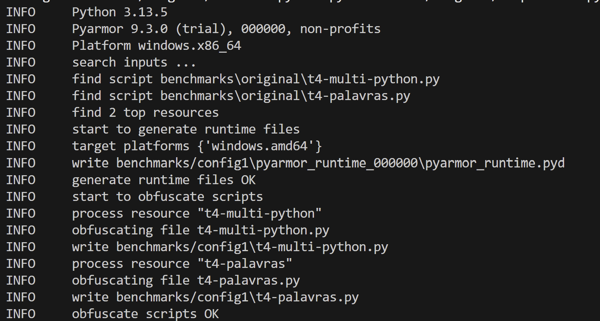
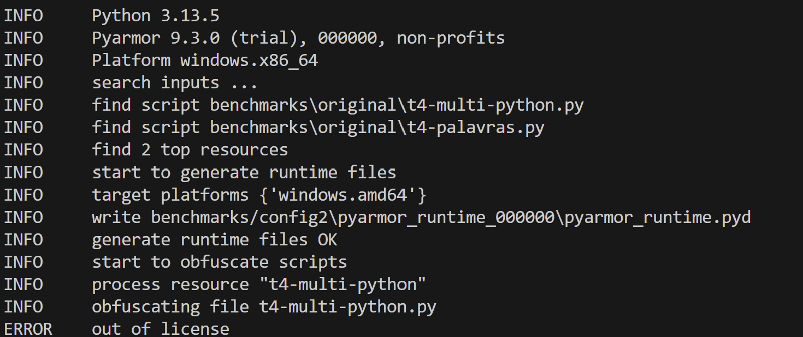
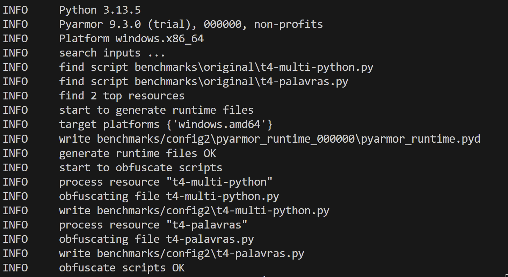
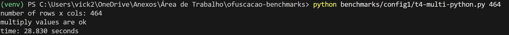
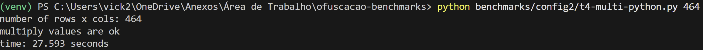
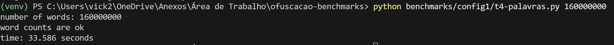
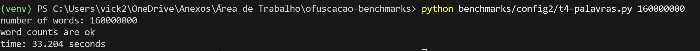

# Trabalho IV - Ofuscação de Código

## A ideia

Ofuscação é transformar o código pra deixá-lo difícil de entender, **sem mudar o que ele faz**. O custo disso é que o programa costuma ficar **mais lento**. Nosso trabalho é medir esse custo: quanto de desempenho a gente perde ao ofuscar.

Quem ofusca é uma **ferramenta pronta** (um "ofuscador"): passamos o código original por ela e recebemos a versão transformada equivalente.

## Os benchmarks

Linguagem: **Python**. São dois programas de tipos diferentes (benchmark = programa feito pra medir desempenho, dá pra cronometrar e comparar):

- **`t4-multi-python.py` - multiplicação de matrizes.** Laço triplo `O(n³)`, pesado em cálculo (aritmética de ponto flutuante). O trecho cronometrado é a multiplicação.
- **`t4-palavras.py` - contagem de palavras.** Conta ocorrências num dicionário, pesado em estrutura de dados / hashing. O trecho cronometrado é só o laço de contagem (`O(n)`, leve - a criação do corpus fica fora da medição).

> Por isso os **tamanhos de entrada vão ser bem diferentes** entre os dois: a matriz atinge 20s com um `n` modesto; a contagem precisa de um `n` bem maior.

## O que vamos medir

| Benchmark        | Versão                   | Medir?                    |
| ---------------- | ------------------------ | ------------------------- |
| Matrizes (multi) | Original (sem ofuscação) | ✅ linha de base da matriz |
| Matrizes (multi) | Ofuscado - config 1      | ✅                         |
| Matrizes (multi) | Ofuscado - config 2      | ✅                         |
| Palavras         | Original (sem ofuscação) | ✅ linha de base de palavras |
| Palavras         | Ofuscado - config 1      | ✅                         |
| Palavras         | Ofuscado - config 2      | ✅                         |

Cada linha dessa tabela ainda se multiplica por **3 tamanhos de entrada × 10 repetições**.

Repare que **cada benchmark tem sua própria versão original como referência** - a comparação é sempre contra o original dele mesmo, **nunca um benchmark contra o outro**.

## A lógica do experimento

São dois eixos diferentes que se cruzam:

- **2 benchmarks** respondem: *o efeito muda conforme o programa?*
- **2 configurações** respondem: *quanto cada nível de ofuscação custa?*

Por isso ambos se cruzam na tabela acima.

## Regras de medição (não esquecer)

- Comparar sempre com o original **da mesma linguagem** - nunca comparar linguagens entre si.
- **3 tamanhos de entrada**, com pelo menos 50% de diferença entre eles.
- A **menor entrada no código original** não pode durar menos de **20 segundos**.
- **10 repetições** por caso; reportar **média, mediana, desvio padrão, mínimo e máximo**.
- Controlar a plataforma durante os testes: fechar outros programas, laptop na tomada, etc.
- Automatizar com script (são muitas execuções).

## Aplicação das técnicas de ofuscação

### 1. Geração dos arquivos ofuscados
Nesta etapa foi utilizada a ferramenta **Pyarmor** para aplicar as técnicas de ofuscação aos programas.

### Configuração 1 - ofuscação de módulo e funções 
Parâmetros utilizados: 
*  --obf-module 1:  aplica ofuscação ao módulo
* -obf-code 1: aplica ofuscação do código das funções

Comando utilizado: 
```
python -m pyarmor.cli gen --obf-module 1 --obf-code 1 -O benchmarks/config1 benchmarks/original/t4-multi-python.py benchmarks/original/t4-palavras.py
```


### Configuração 2 - ofuscação de módulo e proteção de chamadas
Inicialmente foram utilizados os parâmetros:

* --mix-str: proteção de strings
* --obf-code 2:  transformação de acessos a atributos

Comando utilizado:
```
python -m pyarmor.cli gen --obf-module 1 --obf-code 2 --mix-str -O benchmarks/config2 benchmarks/original/t4-multi-python.py benchmarks/original/t4-palavras.py
```


Porém o recuso exige uma licença não disponível no ambiente utilizado. Por isso foi utilizada outra configuração com o parâmetro:
*  --assert-call: adiciona verificações às chamadas de funções protegidas

Comand utilizado: 
```
python -m pyarmor.cli gen --obf-module 1 --obf-code 1 --assert-call -O benchmarks/config2 benchmarks/original/t4-multi-python.py benchmarks/original/t4-palavras.py
```



## 2. Testes de funcionamento dos arquivos ofuscados

### Multiplicação de matrizes
```
python benchmarks/config1/t4-multi-python.py 464
```


```
python benchmarks/config2/t4-multi-python.py 464
```


## Contagem de palavras
```
python benchmarks/config1/t4-palavras.py
```


```
python benchmarks/config2/t4-palavras.py
```
